# 🔐 HACK THE AI — Interactive Cybersecurity CTF Platform

<div align="center">


[](https://hacktheai-five.vercel.app)
[](https://python.org)
[](https://flask.palletsprojects.com)
[](LICENSE)

**Learn Cybersecurity by Breaking Things.**

Practice real-world cybersecurity concepts through interactive labs, missions, and CTF challenges inside a modern simulated environment.

[🚀 Live Demo](https://hacktheai-five.vercel.app) · [📖 Documentation](#-features) · [🐛 Report Bug](https://github.com/lakshaysoni22/HackTheAI/issues) · [✨ Request Feature](https://github.com/lakshaysoni22/HackTheAI/issues)

</div>

---

## 📸 Screenshots

<div align="center">
<table>
<tr>
<td align="center"><b>🏠 Landing Page</b></td>
<td align="center"><b>📊 Dashboard</b></td>
</tr>
<tr>
<td></td>
<td></td>
</tr>
<tr>
<td align="center"><b>🔬 Lab Workstation</b></td>
<td align="center"><b>🕵️ Ghost Ledger Investigation</b></td>
</tr>
<tr>
<td></td>
<td></td>
</tr>
</table>
</div>

---

## ✨ Features

### 🎯 Core Platform
- **Interactive Labs** — 6+ hands-on cybersecurity labs with sequential mission progression
- **CTF Challenges** — Classic Capture The Flag challenges across multiple categories
- **Quiz System** — Mission-based quizzes with intelligent fuzzy answer matching
- **Evidence Collection** — Collect cryptographic evidence as you solve each chapter
- **XP & Leaderboard** — Gamified scoring system with a competitive leaderboard
- **Flag Submission** — Submit flags to prove lab completion

### 🕵️ PRO Lab: The Ghost in the Ledger
- **Custom Investigation Workstation** — Full-screen desktop-style environment inspired by TryHackMe
- **5-Chapter Storyline** — Track a blockchain ghost through wallet forensics, intelligence feeds, and policy engines
- **Auto-Unlock Progression** — Chapters unlock sequentially as you solve each mission
- **Evidence Board** — Visual evidence collection tracking panel

### 🧪 Lab Types
| Type | Description |
|------|-------------|
| **Guided Labs** | Step-by-step missions with quizzes and hints |
| **Manual Labs** | Real vulnerable applications with Docker environments |
| **Interactive Labs** | ZIP-uploaded labs with full workstation UI |
| **PRO Labs** | Story-driven investigations (Ghost Ledger) |

### 🛡️ Security Features
- **CSRF Protection** — Flask-WTF CSRF tokens on all forms and API calls
- **Rate Limiting** — Flask-Limiter to prevent brute force attacks
- **Content Security Policy** — Strict CSP headers via Flask-Talisman
- **Password Hashing** — Werkzeug secure password hashing
- **Session Security** — Configurable cookie-based or Redis-backed sessions

### 👨‍💼 Admin Panel
- **User Management** — View and manage all registered students
- **Lab Upload Engine** — Upload ZIP-based lab packages with manifest configuration
- **Audit Logs** — Track all user actions (quiz attempts, flag submissions, lab restarts)
- **Lab Preview** — Preview uploaded labs before publishing

---

## 🏗️ Tech Stack

| Layer | Technology |
|-------|-----------|
| **Backend** | Python 3.12, Flask 3.0, SQLAlchemy |
| **Database** | SQLite (dev) / PostgreSQL (prod) |
| **Frontend** | Jinja2 Templates, Vanilla CSS, JavaScript |
| **Auth** | Flask-WTF, Werkzeug |
| **Security** | Flask-Talisman, Flask-Limiter, CSRFProtect |
| **Deployment** | Vercel (Serverless Python), Docker |
| **CI/CD** | GitHub → Vercel Auto-Deploy |

---

## 🚀 Quick Start

### Prerequisites
- Python 3.10+
- pip

### Installation

```bash
# 1. Clone the repository
git clone https://github.com/lakshaysoni22/HackTheAI.git
cd HackTheAI

# 2. Create virtual environment
python -m venv venv

# Windows
venv\Scripts\activate

# macOS/Linux
source venv/bin/activate

# 3. Install dependencies
pip install -r requirements.txt

# 4. Run the application
python app.py
```

### 🌐 Access the Platform

```
http://127.0.0.1:5000
```

### Default Credentials

| Role | Username | Password |
|------|----------|----------|
| Admin | `admin` | `admin123` |
| Student | `Alex` | `password123` |

> ⚠️ **Change these passwords immediately in production!**

---

## 📁 Project Structure

```
HackTheAI/
├── app.py                  # Flask application entry point
├── config.py               # Configuration (dev/staging/prod)
├── models.py               # SQLAlchemy database models
├── extensions.py           # Flask extensions (CSRF, Limiter, DB)
├── requirements.txt        # Python dependencies
├── vercel.json             # Vercel deployment config
│
├── routes/                 # Blueprint route handlers
│   ├── api.py              # REST API endpoints (quiz, flag, restart)
│   ├── auth.py             # Login/Register/Logout
│   ├── labs.py             # Lab pages and workstations
│   ├── dashboard.py        # Student dashboard
│   ├── admin.py            # Admin panel
│   ├── leaderboard.py      # XP leaderboard
│   └── pages.py            # Static pages
│
├── services/               # Business logic layer
│   ├── quiz_service.py     # Quiz evaluation with fuzzy matching
│   ├── progress_service.py # Lab/mission unlock logic
│   ├── hint_service.py     # Hint system
│   ├── audit_service.py    # Action logging
│   └── docker_service.py   # Container management
│
├── templates/              # Jinja2 HTML templates
│   ├── base.html           # Master layout
│   ├── landing.html        # Public landing page
│   ├── dashboard.html      # Student dashboard
│   ├── labs.html            # Lab catalog
│   ├── workstation.html    # Lab workstation UI
│   ├── ghost_ledger_workstation.html  # PRO Lab investigation UI
│   └── ...
│
├── static/                 # CSS, JS, Images
│   ├── css/
│   │   ├── core/           # Design system (variables, reset, typography)
│   │   ├── components/     # Reusable component styles
│   │   ├── layout/         # Layout styles
│   │   └── pages/          # Page-specific styles
│   └── js/
│       ├── main.js         # Global utilities
│       ├── workstation.js  # Lab workstation logic
│       └── ghost_ledger_desktop.js  # Investigation UI logic
│
├── database/               # SQL migrations and schema
├── seed_db.py              # Database seeder (labs, missions, quizzes)
├── seed_ghost_ledger.py    # PRO Lab seeder
├── labs/                   # Manual lab Docker apps
└── Dockerfile              # Container deployment
```

---

## 🔄 How Lab Progression Works

```mermaid
graph LR
    A[Lab 1 - Mission 1] -->|Quiz Correct| B[Lab 1 - Mission 2]
    B -->|Quiz Correct| C[Lab 1 - Mission 3]
    C -->|Quiz Correct| D[Lab 1 - Mission 4]
    D -->|Quiz Correct| E[Lab 1 - Mission 5]
    E -->|All Complete + Flag| F[Lab 1 ✅ COMPLETED]
    F -->|Auto Unlock| G[Lab 2 - Mission 1]
```



1. **Intra-Lab:** Complete Mission N → Mission N+1 unlocks automatically
2. **Inter-Lab:** Complete all missions in Lab N → Lab N+1 becomes available
3. **Evidence:** Each completed mission auto-collects cryptographic evidence
4. **Restart:** Full lab restart clears all progress, quizzes, hints, and evidence

---

## 🐳 Docker Deployment

```bash
# Build and run with Docker Compose
docker-compose up --build

# Access at http://localhost:5000
```

---

## 🌐 Vercel Deployment

The project is configured for automatic deployment on Vercel:

1. Push code to GitHub
2. Vercel auto-deploys from the `master` branch
3. Live at: **https://hacktheai-five.vercel.app**

---

## 🤝 Contributing

Contributions are welcome! Please feel free to submit a Pull Request.

1. Fork the Project
2. Create your Feature Branch (`git checkout -b feature/AmazingFeature`)
3. Commit your Changes (`git commit -m 'Add some AmazingFeature'`)
4. Push to the Branch (`git push origin feature/AmazingFeature`)
5. Open a Pull Request

---

## 📜 License

Distributed under the MIT License. See `LICENSE` for more information.

---

## 👤 Author

**Lakshay Soni**
- GitHub: [@lakshaysoni22](https://github.com/lakshaysoni22)

---

<div align="center">

**⭐ Star this repo if you found it useful!**

Made with 💚 and lots of ☕

</div>
